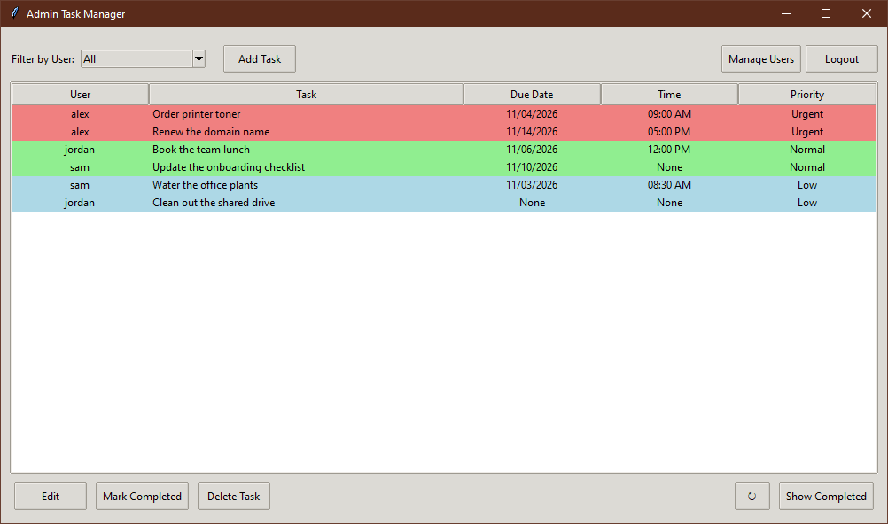
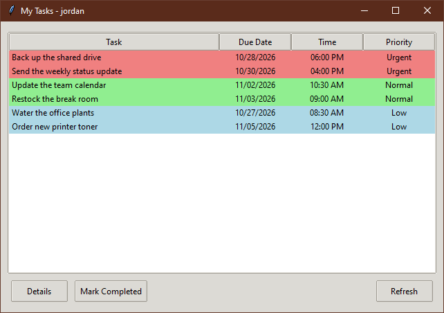
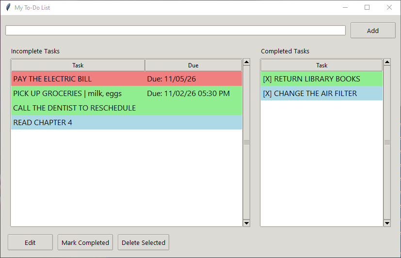

# To-Do List

A shared to-do list for a small team: a Flask server keeps everyone's tasks in one SQLite database,
an admin desktop app (Tkinter) hands out and tracks the work, and a user app lets each person see
and finish their own tasks. A simpler single-window version for one person is included too.



## What it does

**Multi-user version** (`multi/`)

- **Server** (`multi/Server`): a REST API with token logins, rate limiting and interactive API
  docs at the server's root address. On first start it creates an `admin` account.
- **Admin app** (`multi/Admin`): a Tkinter desktop app.
  - See every task, or filter by user. Rows are colored by priority (urgent, normal, low).
  - Add tasks with a calendar date picker and a due time, edit them, mark them done, delete them,
    and view completed tasks in their own window.
  - Manage users: create them, reset passwords, make or remove admins, delete them.
  - Refreshes the task list every 60 seconds.
- **User app** (`multi/User`): a Tkinter desktop app for regular users.
  - Log in and see only the tasks assigned to you, with due date, time and priority, colored the
    same way as in the admin app.
  - Open a task to read its details, and mark it completed when it's done.



**Standalone version** (`standalone/`)



- One window, no server: tasks are saved to a `tasks.json` file in the folder the app runs from.
- Incomplete and completed tasks side by side, colored by priority.
- Due dates and times from a calendar picker, a details field for each task, and web links in the
  details open in the browser when clicked.

## How it works

**Server.** `create_app()` in `multi/Server/app` is a Flask app factory. It reads `config.ini`,
sets up SQLAlchemy, CORS and Flask-Limiter, and registers three Flask-RESTx namespaces under
`/api/v1`: `auth`, `users` and `tasks`. Flask-RESTx generates the Swagger docs from the route
models. Two tables back it: `users` and `tasks`, with each task pointing at its user's name and
deleted along with that user.

- **Logins.** Passwords are stored as bcrypt hashes. A successful login stores a random UUID4
  token and an expiry seven days out on the user's row and returns the token. The clients send it
  as `Authorization: Bearer <token>`, and a `token_required` decorator looks the token up on every
  request, clears it once it has expired and attaches the user to the request.
- **Permissions on the server.** Every route decides from that user what it may do: admins see and
  change every task and manage users; anyone else reads and changes only tasks assigned to them,
  and gets a 403 for anything else. The admin app does not check roles itself, so a regular user
  who logs in to it still sees only their own work.
- **Validation.** Incoming tasks and users go through marshmallow schemas: priority must be
  Urgent, Normal or Low, usernames 3 to 20 characters, and new passwords must be at least 8
  characters with upper and lower case, a digit and a symbol.
- **Rate limiting.** Flask-Limiter counts requests per client IP address against the limits in
  `config.ini` (6,000 a day and 120 an hour by default).

**Desktop apps.** Each app talks to the server through an `APIClient` built on a `requests`
session that carries the token. The admin app runs its server calls on background threads and
hands the results back to Tkinter's main loop with `after(0, ...)`, so its window doesn't freeze
while it waits for the server. Its client caches the user list and task lists for up to five
minutes and clears the task cache after each change it makes; the 60-second refresh reads through
that cache, so changes made by other people can take up to five minutes to appear. Both apps sort
open tasks by priority, then by due date and time (tasks with no date last), and color the rows
with Tkinter `Treeview` tags.

**Standalone app.** One Tkinter file keeps the task list in memory and writes the whole list to
`tasks.json` after every change. Web links in a task's details are found with a regular expression
and tagged in the text widget, and a click on a tagged range opens it with `webbrowser`.

## How to run it

You need Python 3.12. It was built and tested on Windows, where the standard Python installer
includes Tkinter.

**Server**

```
cd multi\Server
pip install -r requirements.txt
copy config.example.ini config.ini
python run.py
```

Edit `config.ini` before you use it for real: set `SECRET_KEY` to a long random string. The
server listens on port 5000. The first start creates an `admin` user with the password `Admin1!`,
or with the password in the `DEFAULT_ADMIN_PASSWORD` environment variable if you set one, so set
that variable before the first start of a real install.

**Admin app** (with the server running)

```
cd multi\Admin
pip install -r requirements.txt
python main.py
```

The server address is in `multi/Admin/config.py` (`http://127.0.0.1:5000/api/v1` by default).

**User app** (with the server running, and a user the admin has created)

```
cd multi\User
pip install -r requirements.txt
python main.py
```

The server address is in `multi/User/config.py`.

**Standalone app**

```
cd standalone
pip install -r requirements.txt
python "My To-Do List.py"
```

The `Server`, `Admin` and `User` folders each have a `Start ... .bat` file that runs the app with
a double-click. The `.spec` files build a single `.exe` with PyInstaller, for example
`pyinstaller main.spec` in `multi\Admin`.

Built with ChatGPT and Claude Code.

## License

MIT. See [LICENSE](LICENSE).
